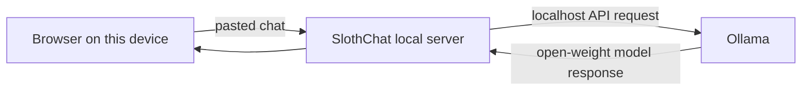

# SlothChat

**Let the chat come to you.** SlothChat turns a pasted group-chat export into a short recap, the decisions and deadlines that matter, and a few suggested replies. It uses an open-weight model through Ollama on your own computer.

## Why this exists

Rejoining a busy group chat can mean scrolling through dozens of messages just to learn one decision. SlothChat does that catch-up in one local request. Paste only the conversation you want summarized; nothing is uploaded to a hosted AI service.

## Run it locally

Requirements: Node.js 18+ and [Ollama](https://ollama.com/).

```sh
ollama pull llama3.2:3b
npm start
```

Open [http://127.0.0.1:4173](http://127.0.0.1:4173). Choose another model by typing its installed Ollama model name in the model field, or set `OLLAMA_MODEL` before starting the server. Keep Ollama running in the background.

## Privacy

The web app listens only on `127.0.0.1`. Chat text is sent to the Ollama API at `127.0.0.1:11434` on the same machine and is not written to disk by this app. The fonts load from Google Fonts; to use the interface without that third-party request, remove the `@import` line in `public/styles.css` (the system font fallback will be used).

## What it returns

- A two-sentence catch-up
- Low-priority threads you can ignore
- Decisions, deadlines, and explicit requests
- Optional reply suggestions grounded in the pasted text

The model can still misunderstand a message. Check important dates and commitments against the original conversation.

## Architecture



## License

MIT. See [LICENSE](LICENSE).
